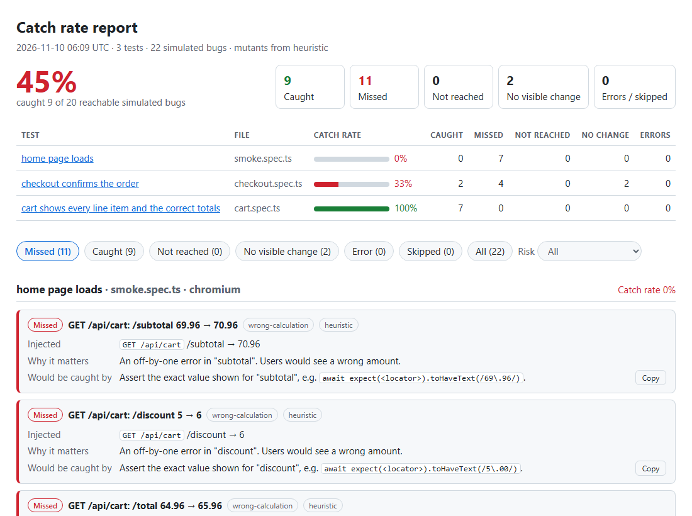
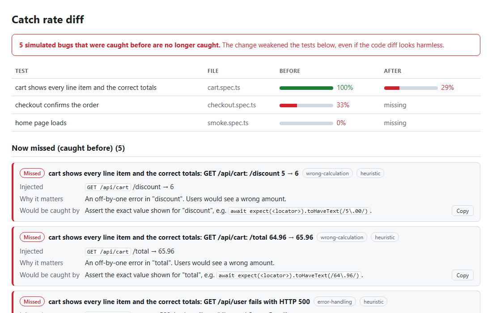

# catchrate

[](https://github.com/jeanljh/catchrate/actions/workflows/ci.yml)
[](LICENSE)
[](package.json)
[](tsconfig.json)

**Would your Playwright tests catch a real backend bug?** catchrate measures it. It injects realistic bugs into the API responses your app receives during a test run: a wrong total, a missing cart item, a failed checkout. Then it reports which bugs each test caught and which it missed. For every missed bug it suggests the assertion that would have caught it.

It also catches tests that **got weaker**. Run it before and after a self-heal, a coding agent's edit or a refactor. If a test stops catching bugs it used to catch, `catchrate diff` lists them and exits 1, even when the code change looks harmless.



## Why this exists

A green E2E test proves the page loaded. It doesn't prove the test checks anything. Existing tools come at the problem from other angles:
- Mutation testing tools (Stryker, PIT, mutmut) change source code and work at the unit level.
- The existing Playwright "mutation" tools invert a test's own assertions.
- Self-healing tools make tests pass again without checking what they still verify.

catchrate mutates the **data the UI receives**, which is where many real bugs show up. That means:
- No access to the backend's source is needed.
- It works with any backend stack.
- Your tests run unchanged apart from one import line.

## Quick start

1. Install it next to Playwright (Node.js 20.12 or later). It isn't on npm yet, so install it from GitHub:

   ```bash
   npm install --save-dev github:jeanljh/catchrate
   ```

2. In your specs, import `test` and `expect` from the fixture instead of `@playwright/test`:

   ```ts
   import { test, expect } from 'catchrate/fixture';
   ```

   If you already extend `test`, merge the two:

   ```ts
   import { mergeTests } from '@playwright/test';
   import { test as strengthTest } from 'catchrate/fixture';

   export const test = mergeTests(yourTest, strengthTest);
   ```

   With no `CATCHRATE_*` environment variables set, the fixture does nothing, so normal runs are unaffected.

3. Run an audit, then open `.catchrate/report.html` in a browser. `report.md` and `report.json` sit next to it:

   ```bash
   npx catchrate audit
   ```

### Try the demo

```bash
git clone https://github.com/jeanljh/catchrate.git
cd catchrate
npm ci
npx playwright install chromium
npm run build
npm run demo:audit   # audit the demo shop
npm run demo:heal    # re-run with a weakened test and diff (exits 1 by design)
```

## How it works

1. **`record`** runs your suite once. For each passing test it saves the `fetch`/XHR responses (method, path, status, body) and an accessibility snapshot of the final page.
2. **`propose`** creates up to 8 *mutants* per test. A mutant is one simulated bug, written as data: a target request plus [JSON Patch](https://datatracker.ietf.org/doc/html/rfc6902)-style operations (`replace`, `remove`, `add`, `move`, `copy`), `status` and `setBody`. Every mutant is dry-run against the recording, and any that don't apply or change nothing are dropped. Mutants come from one of two sources:
   - **Heuristics (default, offline, free).** They change or blank out values that appear on the final page (so the user would see the bug), drop list entries, and turn requests into 500 errors with an error body.
   - **An LLM (`--llm`): Claude, OpenAI-compatible APIs, or a local model through Ollama or LM Studio.** The model reads the test's source, the recorded responses and the page snapshot, and proposes domain-aware bugs, such as another customer's order or a stale status, with an assertion hint in your test's own locator style.
3. **`run`** runs each test twice without changes (the *controls*, first and last) and once per mutant, in a single Playwright process (`--repeat-each`, `--retries=0`). The fixture serves the mutated response through `context.route()` and `route.fetch()`. Each mutant ends up as one of:

| Outcome | Meaning | Counted in score |
|---|---|---|
| caught (killed) | the test failed with the bug injected | yes |
| missed (survived) | the test passed with the bug injected | yes |
| not reached | the test never made the targeted request | no |
| no visible change | the final page looked the same as the controls', so no UI check could see the bug. Clocks and live data are allowed to change, but their format isn't (see Limitations). | no |
| skipped / error | a control run failed (flaky test), the test was missing, or the run broke | no |

   **Catch rate** = caught ÷ (caught + missed).
4. **`diff`** compares two reports made from the same `mutants.json`. A bug that was caught before and now survives, or that the test no longer reaches, counts as a regression.

### Reports

Every `run` writes three files to `.catchrate/`:

| File | For |
|---|---|
| `report.html` | Reading. A single self-contained page: overall and per-test scores, missed bugs first, filters by outcome and risk, and a copy button for each suggested assertion. Works offline, in light and dark mode, on any screen size. |
| `report.md` | Posting as a PR comment. |
| `report.json` | Machines: `diff`, CI gates, your own tooling. |

`diff --html heal-diff.html` writes the before/after comparison as a page too:



The HTML is safe to open from untrusted runs:
- All text from tests, responses and models is escaped.
- The page makes no network requests.
- A strict Content-Security-Policy allows only its own inline script, pinned by hash.

The design rationale is in [docs/DESIGN.md](docs/DESIGN.md).

## Commands

```text
catchrate audit                 record + propose + run
catchrate record                record API responses
catchrate propose [--llm]       generate mutants
catchrate run                   run mutants, write report.json and report.md
catchrate diff <before> <after> compare reports; exit 1 if a test got weaker
catchrate report [report.json]  print a saved report
```

| Option | Default | |
|---|---|---|
| `--cwd <dir>` | `.` | project to audit (where Playwright runs) |
| `--config <file>` | Playwright's | Playwright config |
| `--project <name>` | all | one Playwright project |
| `--grep <regex>` | all | only matching tests (`record`, `audit`) |
| `--out-dir <dir>` | `<cwd>/.catchrate` | recordings, mutants, reports |
| `--llm` | off | use an LLM to propose mutants |
| `--provider <name>` | `claude` | `claude`, `openai`, `ollama` or `lmstudio` (implies `--llm`) |
| `--model <id>` | `claude-opus-5-5` for Claude | model name (required for other providers) |
| `--base-url <url>` | the preset's | server URL for `openai`, `ollama` or `lmstudio` |
| `--effort <level>` | `medium` | Claude only: `low` / `medium` / `high` / `xhigh` / `max` |
| `--max-per-test <n>` | 8 | mutants per test |
| `--mutants <file>` | `<out-dir>/mutants.json` | mutants to run |
| `--out <file>` | `<out-dir>/report.json` | report path (`.md` and `.html` are written next to it) |
| `--html <file>` | | `diff`, `report`: write a self-contained HTML page |
| `--workers <n>` | half your CPUs, max 4 | parallel browsers per test |
| `--timeout <ms>` | config's | per-test timeout during `run` |
| `--min-score <0-100>` | none | exit 1 if the overall catch rate is below this |
| `--redact-keys <a,b>` | | extra JSON keys to mask in recordings |
| `--no-redact` | | store response bodies unmasked (not recommended) |
| `-v`, `--version` | | print the version |

### Programmatic API

Everything the CLI does is also exported, with types:

```ts
import { proposeHeuristic, runMutants, buildReport, diffReports } from 'catchrate';
import type { Mutant, Report } from 'catchrate';
```

## Catching a weakened test in CI

Commit `mutants.json` together with a baseline report. Then, on every PR that touches tests:

```bash
npx catchrate run --mutants .catchrate/mutants.json --out after.json
npx catchrate diff .catchrate/report.json after.json --out strength-diff.md --html strength-diff.html
```

The diff exits 1 when a test stopped catching a bug it used to catch. Post `strength-diff.md` as a PR comment, and upload `strength-diff.html` as a build artifact.

In the demo, the "healed" cart test (`examples/shop/tests-healed`) still passes but has looser checks. `npm run demo:heal` shows its score dropping from 100% to 29% and lists the five bugs it no longer catches. This repository's CI runs that check on every push.

## Using an LLM (`--llm`)

An LLM is optional. Without one, the offline heuristics generate the mutants. With one, the model reads your test's source, the recorded responses and the page snapshot, and proposes bugs specific to your app's domain. Any of these backends works:

| `--provider` | Backend | Key | Example |
|---|---|---|---|
| `claude` (default) | Anthropic Claude | `ANTHROPIC_API_KEY` or `ant auth login` | `--llm` |
| `ollama` | Local [Ollama](https://ollama.com) at `localhost:11434` | none | `--provider ollama --model qwen3:14b` |
| `lmstudio` | Local [LM Studio](https://lmstudio.ai) at `localhost:1234` | none | `--provider lmstudio --model <model id>` |
| `openai` | OpenAI, or **any OpenAI-compatible API** via `--base-url` (OpenRouter, Gemini's compatible endpoint, vLLM, llama.cpp …) | `OPENAI_API_KEY`, or `CATCHRATE_API_KEY` for other servers | `--provider openai --base-url https://openrouter.ai/api/v1 --model <id>` |

```bash
# Fully local and private: run a model with Ollama, then
npx catchrate audit --provider ollama --model qwen3:14b
```

- **Keys.** The CLI reads a `.env` file in the directory you run it from (copy [.env.example](.env.example)). The file is git-ignored, and variables already set in your environment take precedence over it. Local servers need no key.
- **Checks before sending.** Before any test is sent, one cheap call confirms the key works, the server is reachable and the model exists. A setup problem stops the run with a clear message instead of failing every test.
- **Structured output.** Claude and servers that support JSON-schema output return guaranteed-valid JSON. For servers that don't, catchrate automatically falls back to JSON mode and then to plain text, extracting the JSON from the reply. Every suggested mutant is validated and dry-run either way, so a weaker model produces fewer usable mutants, never a broken run.
- **Claude specifics.** `--effort` (default `medium`) and server-side refusal fallback (`fallbacks: "default"`), which retries a declined request on Anthropic's recommended fallback model.
- **Failures.** If the model fails for one test, that test falls back to the heuristic mutants and the run continues.
- **What leaves your machine.** The test's source file, its recorded API responses (bodies are cut at 30k characters each) and the final page's accessibility snapshot, all with secrets masked (see [Security](#security)). With `ollama` or `lmstudio` nothing leaves your machine. With a hosted provider, don't use `--llm` on suites that run against real customer data.
- **Cost.** The model is called only in `propose`. `run` never calls it, so re-running in CI costs nothing beyond browser time.

## Security

- **Recordings are redacted by default.** Passwords, tokens, API keys, cookies, JWTs and similar values are replaced with `[REDACTED]` before anything is written to disk or sent to a model. Query strings are dropped from recorded URLs.
- **`mutants.json` is validated** before every run, so a tampered file can't write outside the output folder or add anything but mutation data.
- **Reports escape untrusted text,** so they're safe to post as PR comments.
- **API keys are never sent over plain HTTP** to another machine.

Details and how to report a vulnerability: [SECURITY.md](SECURITY.md).

## Limitations

- Only `fetch`/XHR traffic from the browser is mutated. Calls made with Playwright's `request` fixture, WebSockets, server-sent events, and pages served by a service worker are not. Set `serviceWorkers: 'block'` if your app uses one.
- Requests are matched by method and pathname. A mutant applies to every matching response in the test.
- "No visible change" compares only the final page. A bug that briefly shows something and then recovers counts as no visible change.
- Lines that change on their own between the two control runs (prices, counters) and clock-like lines are treated as live data. On those lines, only a change in format counts as visible: `27,910.90` → `27,910.900` does, a different price doesn't. A bug that only changes a live value is therefore classed as "no visible change".
- Heuristic mutants can still be equivalent to the original (for example, the same number appears in two responses). Claude mode and the visible-change check reduce this.
- Tests in `describe.serial` blocks that depend on earlier tests can't run alone, so they show up as unstable.
- Playwright only for now.

## License

[MIT](LICENSE) © jeanljh

Release notes are in [CHANGELOG.md](CHANGELOG.md). This project follows a [Code of Conduct](CODE_OF_CONDUCT.md).
